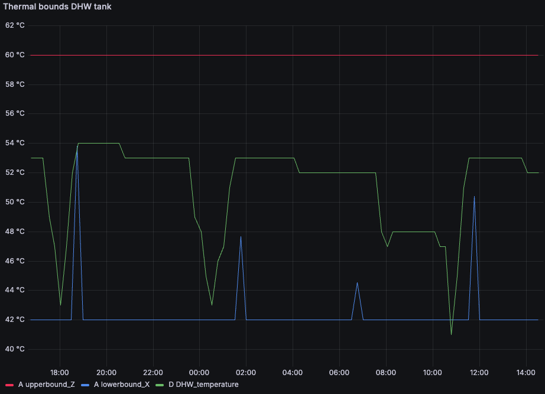

<Note>
    This feature only exists if you are using the partner control package. If you are using the NOX control package, you can skip this section.
</Note>

For partners who want to run their own optimization, a set of additional endpoints exposes the heat pump in a form that is ready to optimize.

This data is deliberately expressed in a way similar to how a battery would be described: a value representing the current state of the system (the current temperature), an upper and a lower bound, a passive drain, a charge rate, and the electrical power that comes with it. The intent is that no modeling of the heat pump, the domestic hot water tank or the house is required, allowing partners to focus on the optimization itself.

## Getting Heat pump information representated as a thermal battery

Each heat pump is exposed as two independent parts: the domestic hot water (DHW) tank and the house. Two endpoints carry the model. [`current-state`](/api-docs/hp/thermal-battery-control/get-thermal-control-current-state) returns the measured thermal state and refreshes every 15 minutes; [`forecast`](/api-docs/hp/thermal-battery-control/get-thermal-control-forecast) returns the comfort bounds and the expected thermal behaviour as 15-minute records, 72 hours ahead, regenerated hourly.

This section works through a complete DHW scheduling decision and introduces each field at the point where it is used. The exhaustive field reference for both endpoints, including the deprecated `Q_*` variants, is in the API reference.

### The battery model

The chart below shows the DHW tank of a single device over roughly 20 hours.



`DHW_temperature` (green) is the state of charge; `upperbound_Z` (red) and `lowerbound_X` (blue) are the limits it has to stay between. The steep declines are hot water draw-off, which you do not control. The sharp recoveries are heat pump activations, which you do.

Scheduling therefore reduces to one binary decision per 15-minute slot: activate, or do not. The rest of this section covers the data needed to make that decision well.

### Establishing the current state

The scenario used throughout is a device at `2025-01-15 11:58 UTC`, with day-ahead prices low over the early afternoon and high from 17:00 onwards.

<CodeGroup dropdown>

```bash cURL
curl --request GET \
  --url 'https://api.nox.energy/v1/device/thermal-control/current-state?device_id=HP123456&unit=celsius' \
  --header 'x-api-key: <api-key>'
```

```python Python
import requests

url = "https://api.nox.energy/v1/device/thermal-control/current-state?device_id=HP123456&unit=celsius"

headers = {"x-api-key": "<api-key>"}

response = requests.get(url, headers=headers)

print(response.text)
```

```javascript JavasScript
const options = {method: 'GET', headers: {'x-api-key': '<api-key>'}};

fetch('https://api.nox.energy/v1/device/thermal-control/current-state?device_id=HP123456&unit=celsius', options)
  .then(res => res.json())
  .then(res => console.log(res))
  .catch(err => console.error(err));
```

```php PHP
<?php

$curl = curl_init();

curl_setopt_array($curl, [
  CURLOPT_URL => "https://api.nox.energy/v1/device/thermal-control/current-state?device_id=HP123456&unit=celsius",
  CURLOPT_RETURNTRANSFER => true,
  CURLOPT_ENCODING => "",
  CURLOPT_MAXREDIRS => 10,
  CURLOPT_TIMEOUT => 30,
  CURLOPT_HTTP_VERSION => CURL_HTTP_VERSION_1_1,
  CURLOPT_CUSTOMREQUEST => "GET",
  CURLOPT_HTTPHEADER => [
    "x-api-key: <api-key>"
  ],
]);

$response = curl_exec($curl);
$err = curl_error($curl);

curl_close($curl);

if ($err) {
  echo "cURL Error #:" . $err;
} else {
  echo $response;
}
```

```go Go
package main

import (
	"fmt"
	"net/http"
	"io"
)

func main() {

	url := "https://api.nox.energy/v1/device/thermal-control/current-state?device_id=HP123456&unit=celsius"

	req, _ := http.NewRequest("GET", url, nil)

	req.Header.Add("x-api-key", "<api-key>")

	res, _ := http.DefaultClient.Do(req)

	defer res.Body.Close()
	body, _ := io.ReadAll(res.Body)

	fmt.Println(string(body))

}
```

```java Java
HttpResponse<String> response = Unirest.get("https://api.nox.energy/v1/device/thermal-control/current-state?device_id=HP123456&unit=celsius")
  .header("x-api-key", "<api-key>")
  .asString();
```

```ruby Ruby
require 'uri'
require 'net/http'

url = URI("https://api.nox.energy/v1/device/thermal-control/current-state?device_id=HP123456&unit=celsius")

http = Net::HTTP.new(url.host, url.port)
http.use_ssl = true

request = Net::HTTP::Get.new(url)
request["x-api-key"] = '<api-key>'

response = http.request(request)
puts response.read_body
```

</CodeGroup>

Restricted to the tank, the response is:

```json
{
  "data": {
    "timestamp": "2025-01-15 11:58:12",
    "tank": {
      "DHW_temperature": 43.0,
      "T_loss": 0.29,
      "T_gain": [7.65, 7.65, 7.65, 7.65],
      "P_if_activated": [2.37, 2.89, 3.27, 3.48]
    }
  }
}
```

`DHW_temperature` is measured rather than predicted, which makes it the only defensible initial condition for a forward simulation. This endpoint is also what you poll to detect a device drifting towards its comfort bounds.

### Comfort bounds and activation constraints

<CodeGroup dropdown>

```bash cURL
curl --request GET \
  --url 'https://api.nox.energy/v1/device/thermal-control/forecast?device_id=HP123456&unit=celsius&start_time=2023-10-01T00%3A00%3A00Z&end_time=2023-10-02T00%3A00%3A00Z' \
  --header 'x-api-key: <api-key>'
```

```python Python
import requests

url = "https://api.nox.energy/v1/device/thermal-control/forecast?device_id=HP123456&unit=celsius&start_time=2023-10-01T00%3A00%3A00Z&end_time=2023-10-02T00%3A00%3A00Z"

headers = {"x-api-key": "<api-key>"}

response = requests.get(url, headers=headers)

print(response.text)
```

```javascript JavasScript
const options = {method: 'GET', headers: {'x-api-key': '<api-key>'}};

fetch('https://api.nox.energy/v1/device/thermal-control/forecast?device_id=HP123456&unit=celsius&start_time=2023-10-01T00%3A00%3A00Z&end_time=2023-10-02T00%3A00%3A00Z', options)
  .then(res => res.json())
  .then(res => console.log(res))
  .catch(err => console.error(err));
```

```php PHP
<?php

$curl = curl_init();

curl_setopt_array($curl, [
  CURLOPT_URL => "https://api.nox.energy/v1/device/thermal-control/forecast?device_id=HP123456&unit=celsius&start_time=2023-10-01T00%3A00%3A00Z&end_time=2023-10-02T00%3A00%3A00Z",
  CURLOPT_RETURNTRANSFER => true,
  CURLOPT_ENCODING => "",
  CURLOPT_MAXREDIRS => 10,
  CURLOPT_TIMEOUT => 30,
  CURLOPT_HTTP_VERSION => CURL_HTTP_VERSION_1_1,
  CURLOPT_CUSTOMREQUEST => "GET",
  CURLOPT_HTTPHEADER => [
    "x-api-key: <api-key>"
  ],
]);

$response = curl_exec($curl);
$err = curl_error($curl);

curl_close($curl);

if ($err) {
  echo "cURL Error #:" . $err;
} else {
  echo $response;
}
```

```go Go
package main

import (
	"fmt"
	"net/http"
	"io"
)

func main() {

	url := "https://api.nox.energy/v1/device/thermal-control/forecast?device_id=HP123456&unit=celsius&start_time=2023-10-01T00%3A00%3A00Z&end_time=2023-10-02T00%3A00%3A00Z"

	req, _ := http.NewRequest("GET", url, nil)

	req.Header.Add("x-api-key", "<api-key>")

	res, _ := http.DefaultClient.Do(req)

	defer res.Body.Close()
	body, _ := io.ReadAll(res.Body)

	fmt.Println(string(body))

}
```

```java Java
HttpResponse<String> response = Unirest.get("https://api.nox.energy/v1/device/thermal-control/forecast?device_id=HP123456&unit=celsius&start_time=2023-10-01T00%3A00%3A00Z&end_time=2023-10-02T00%3A00%3A00Z")
  .header("x-api-key", "<api-key>")
  .asString();
```

```ruby Ruby
require 'uri'
require 'net/http'

url = URI("https://api.nox.energy/v1/device/thermal-control/forecast?device_id=HP123456&unit=celsius&start_time=2023-10-01T00%3A00%3A00Z&end_time=2023-10-02T00%3A00%3A00Z")

http = Net::HTTP.new(url.host, url.port)
http.use_ssl = true

request = Net::HTTP::Get.new(url)
request["x-api-key"] = '<api-key>'

response = http.request(request)
puts response.read_body
```

</CodeGroup>

The forecast returns one record per 15 minutes. The record covering 12:00–12:15 is:

```json
{
  "timestamp": "2025-01-15 12:00:00",
  "tank": {
    "upperbound_Z": 60,
    "lowerbound_X": 42,
    "Y_avg": 51,
    "T_loss": 0.29,
    "T_gain": [7.65, 7.65, 7.65, 7.65],
    "P_if_activated": [2.37, 2.89, 3.27, 3.48],
    "tank_activation_limit_temp": 55
  }
}
```

`upperbound_Z` and `lowerbound_X` delimit the usable capacity. At 60 °C and 42 °C respectively, a tank measuring 43.0 °C is close to depleted and has roughly 17 °C of headroom.

`upperbound_Z` is the appliance's maximum DHW setpoint and is effectively constant. `lowerbound_X` is not. In the chart it rests at 42 °C but rises for isolated 15-minute intervals; each of those is positioned immediately ahead of hot water demand we expect the household to draw, and raises the floor to the temperature required to serve it. Treat such an interval as a deadline, the tank must be at least that warm by then. It is visible only in the forecast, never in the current state, which is the main reason to plan against the forecast rather than react to the measured temperature.

`tank_activation_limit_temp` is a hard precondition. A heat pump only initiates a DHW cycle once the tank has fallen below its own restart threshold, being the appliance's maximum setpoint minus its hysteresis. We report that threshold; we do not impose it. At 43.0 °C the tank is below the 55 °C limit, so an activation will take effect. Above the limit, a request to heat the tank is accepted by the API and then produces nothing.

<Note>
  `Y_avg` is the midpoint of the comfort band, `(60 + 42) / 2`, and used as a reference to calculate `T_loss, T_gain & P_if_activated`, since these variables are temperature dependent. `Y_avg` is not a prediction of the tank temperature. It should not be used as the initial condition of a simulation.
</Note>

### Activation profiles

`T_gain` and `P_if_activated` describe the consequences of activating. Both are arrays, because both change as an activation progresses.

Each array describes **one activation, divided into consecutive quarter hours**. Index `0` covers minutes 0–15 of that activation, index `1` minutes 15–30, and so on. `T_gain` is the temperature the water gains over each quarter, in °C; `P_if_activated` is the average electrical power drawn over the same quarter, in kW.

<Warning>
  The indices are positions in time, not selectable power levels. Index `3` is not a higher setting. It is the state of the same activation after 45 minutes of running. An activation beginning at 12:15 rather than 12:00 is read from index `0` of the 12:15 record: the arrays are always relative to the moment of activation, never to the clock.
</Warning>

Tank profiles hold 4 values, covering 1 hour, since DHW cycles on most brands are shorter than that. Space heating and cooling profiles hold 8 values, covering 2 hours. To model an activation running beyond the end of an array, hold its last value.

`P_if_activated` typically increases across the array because the same activation becomes less efficient as it proceeds: a warmer tank requires a higher condensing temperature, which costs more electrical power per unit of heat delivered. That higher power is not available at a lower tank temperature, as heat exchanger sizing caps the input at any given temperature. Read side by side, the two arrays show the efficiency degrading over the cycle: 7.65 °C of gain for 2.37 kW in the first quarter, the same gain for 3.48 kW in the fourth.

Note that `P_if_activated` is returned in kW under both `unit` settings.

### Standing loss and expected demand

`T_loss` is the temperature the tank loses over the record's 15-minute slot if it is not activated. It is a scalar rather than an array, since the loss does not depend on how long the heat pump has been running.

It is not restricted to insulation losses. `T_loss` also carries the hot water we expect the household to draw during that interval, so it is a fraction of a degree overnight and can reach several degrees in an interval containing expected demand. Because the value varies per record, a forward simulation must read each record's own `T_loss` rather than assume a constant.

### Worked example: scheduling a DHW cycle

Starting from the measured 43.0 °C and using the 12:00 record, simulate an activation beginning at the next quarter hour. Per quarter, apply `T_gain` and subtract `T_loss`, stopping before `upperbound_Z` is crossed:

| Quarter | Interval | Index | Start | `T_gain` | `T_loss` | End | `P_if_activated` | Energy |
| --- | --- | --- | --- | --- | --- | --- | --- | --- |
| 1 | 12:00–12:15 | `0` | 43.00 °C | +7.65 | −0.29 | 50.36 °C | 2.37 kW | 0.593 kWh |
| 2 | 12:15–12:30 | `1` | 50.36 °C | +7.65 | −0.29 | 57.72 °C | 2.89 kW | 0.723 kWh |
| 3 | 12:30–12:45 | `2` | 57.72 °C | +7.65 | −0.29 | 65.08 °C | — | — |

Two quarters fit; a third would exceed 60 °C. The activation runs from 12:00 to 12:30 and consumes `(2.37 + 2.89) × 0.25 h = 1.32 kWh`.

That figure is also the answer to how much electrical energy the device can absorb at this moment: 1.32 kWh over 30 minutes, limited by the comfort bound rather than by the compressor rating. Priced against the corresponding day-ahead intervals, it can be compared directly against activating later in the day.

To establish when the next activation becomes necessary, continue the simulation past 12:30 without activating, subtracting each record's `T_loss` and testing the result against that record's `lowerbound_X`. Whichever occurs first, depletion to the standing floor, or a floor raised ahead of expected demand, sets the deadline.

The resulting decision is submitted as a schedule:

```json
{
  "device_id": "HP123456",
  "timestamp": "2025-01-15T12:00:00Z",
  "tank": [true, true, false, false, "... 92 more"]
}
```

See [5.2](#5-2-controlling-the-heat-pump) for the request itself and for the failsafes that can override it, including the cut-off that terminates DHW heating after 1 continuous hour.

The pattern generalises to a model predictive controller: take the measured temperature, simulate forward under `T_gain` while activating and `T_loss` while not, constrain the trajectory to the bounds, and select the cheapest feasible schedule. Recompute as new data lands, `current state` every 15 minutes, `forecast` every hour, retain only the leading slots of each solution, and submit only when the plan changes.

<Note>
  Two refinements to the simulation. `T_gain` is a gross gain, so the strict per-quarter update is `+T_gain − T_loss`; for the tank that correction is minor except in intervals carrying expected demand. And the profiles attached to a record are computed by simulating an activation starting from that record's `Y_avg`, so their accuracy degrades as your simulated temperature diverges from the middle of the band.
</Note>

### Space heating and cooling

The house battery follows the same structure under different field names:

| DHW tank | House |
| --- | --- |
| `T_loss`, always a loss | `T_natural`, signed: solar gain warms the building, cold weather cools it |
| `T_gain` | `T_heating`, plus `T_cooling` on devices that support cooling |
| `P_if_activated` | `P_heating` / `P_cooling` |
| 4-value profiles (1 hour) | 8-value profiles (2 hours) |
| `tank_activation_limit_temp` gates activation | no equivalent |

The house additionally returns `Y_ideal`, the temperature the user sees as his ideal temperature between their comfort bounds.

Simulation is identical in form: apply `T_heating` or `T_cooling` per quarter while activating and `T_natural` while not, and keep the trajectory within `lowerbound_X` and `upperbound_Z`.

### Units

Every example above uses `unit=celsius`. The endpoints still default to `unit=kWh`, which returns the same model with state and bounds expressed in kWh and thermal flows as `Q_loss` / `Q_gain` / `Q_natural` in kW. We intend to phase that representation out.

<Warning>
  The kWh view is derived from the temperature model through a fixed thermal capacity. For our more advanced models that conversion loses physical meaning and can yield implausible COPs, particularly on systems with fast dynamics such as air-to-air units. The celsius values are what the models produce directly, and will remain correct as those models develop.
</Warning>

Migration carries no functional cost. The `P_*` fields are returned in kW under either setting, so energy, cost and consumption reporting are unaffected by the change.

### Call frequency

| Endpoint | New data | Purpose |
| --- | --- | --- |
| [`/device/thermal-control/current-state`](/api-docs/hp/thermal-battery-control/get-thermal-control-current-state) | every 15 minutes | measured initial condition; monitoring devices approaching their comfort bounds |
| [`/device/thermal-control/forecast`](/api-docs/hp/thermal-battery-control/get-thermal-control-forecast) | every hour | scheduling: comfort bounds and expected behaviour up to ~36 hours ahead |

The forecast is most accurate over approximately the first 12 hours and degrades gradually beyond that, being dependent on weather forecasts and occupant behaviour. Because it is regenerated hourly, querying it once per hour always returns the current best prediction; polling more frequently returns the same data.

Comfort bounds should not be cached. They change when the heat pump switches between heating and cooling operation, and when the user modifies their comfort settings.

## Controlling the heat pump

<Note>
    This feature only exists if you are using the partner control package. If you are using the NOX control package, you can skip this section.
</Note>

Submit a 24-hour steering schedule with `POST /device/thermal-control/schedule`. The schedule has 96 slots of 15 minutes each, starting from the next quarter-hour (e.g. submit at 10:07 → the schedule runs from 10:15 to 10:00 the next day). Only submit a new schedule when you actually want to change it.

<CodeGroup dropdown>

```bash cURL
curl --request POST \
  --url https://api.nox.energy/v1/device/thermal-control/schedule \
  --header 'x-api-key: <api-key>' \
  --header 'Content-Type: application/json' \
  --data '{
  "device_id": "HP123456",
  "timestamp": "2025-08-05T10:15:00Z",
  "house_heating": [true, false, false, true, false, false, false, false],
  "house_cooling": [false, false, false, false, false, false, false, false],
  "tank": [false, false, true, false, false, false, false, false]
}'
```

```python Python
import requests

url = "https://api.nox.energy/v1/device/thermal-control/schedule"

headers = {"x-api-key": "<api-key>", "Content-Type": "application/json"}

payload = {
    "device_id": "HP123456",
    "timestamp": "2025-08-05T10:15:00Z",
    "house_heating": [True, False, False, True, False, False, False, False],
    "house_cooling": [False, False, False, False, False, False, False, False],
    "tank": [False, False, True, False, False, False, False, False]
}

response = requests.post(url, headers=headers, json=payload)

print(response.text)
```

```javascript JavasScript
const options = {
  method: 'POST',
  headers: {'x-api-key': '<api-key>', 'Content-Type': 'application/json'},
  body: JSON.stringify({
    device_id: 'HP123456',
    timestamp: '2025-08-05T10:15:00Z',
    house_heating: [true, false, false, true, false, false, false, false],
    house_cooling: [false, false, false, false, false, false, false, false],
    tank: [false, false, true, false, false, false, false, false]
  })
};

fetch('https://api.nox.energy/v1/device/thermal-control/schedule', options)
  .then(res => res.json())
  .then(res => console.log(res))
  .catch(err => console.error(err));
```

```php PHP
<?php

$curl = curl_init();

curl_setopt_array($curl, [
  CURLOPT_URL => "https://api.nox.energy/v1/device/thermal-control/schedule",
  CURLOPT_RETURNTRANSFER => true,
  CURLOPT_ENCODING => "",
  CURLOPT_MAXREDIRS => 10,
  CURLOPT_TIMEOUT => 30,
  CURLOPT_HTTP_VERSION => CURL_HTTP_VERSION_1_1,
  CURLOPT_CUSTOMREQUEST => "POST",
  CURLOPT_POSTFIELDS => json_encode([
    "device_id" => "HP123456",
    "timestamp" => "2025-08-05T10:15:00Z",
    "house_heating" => [true, false, false, true, false, false, false, false],
    "house_cooling" => [false, false, false, false, false, false, false, false],
    "tank" => [false, false, true, false, false, false, false, false]
  ]),
  CURLOPT_HTTPHEADER => [
    "x-api-key: <api-key>",
    "Content-Type: application/json"
  ],
]);

$response = curl_exec($curl);
$err = curl_error($curl);

curl_close($curl);

if ($err) {
  echo "cURL Error #:" . $err;
} else {
  echo $response;
}
```

```go Go
package main

import (
	"bytes"
	"encoding/json"
	"fmt"
	"net/http"
	"io"
)

func main() {

	url := "https://api.nox.energy/v1/device/thermal-control/schedule"

	payload, _ := json.Marshal(map[string]interface{}{
		"device_id":     "HP123456",
		"timestamp":     "2025-08-05T10:15:00Z",
		"house_heating": []bool{true, false, false, true, false, false, false, false},
		"house_cooling": []bool{false, false, false, false, false, false, false, false},
		"tank":          []bool{false, false, true, false, false, false, false, false},
	})

	req, _ := http.NewRequest("POST", url, bytes.NewBuffer(payload))

	req.Header.Add("x-api-key", "<api-key>")
	req.Header.Add("Content-Type", "application/json")

	res, _ := http.DefaultClient.Do(req)

	defer res.Body.Close()
	body, _ := io.ReadAll(res.Body)

	fmt.Println(string(body))

}
```

```java Java
HttpResponse<String> response = Unirest.post("https://api.nox.energy/v1/device/thermal-control/schedule")
  .header("x-api-key", "<api-key>")
  .header("Content-Type", "application/json")
  .body("{\"device_id\":\"HP123456\",\"timestamp\":\"2025-08-05T10:15:00Z\",\"house_heating\":[true,false,false,true,false,false,false,false],\"house_cooling\":[false,false,false,false,false,false,false,false],\"tank\":[false,false,true,false,false,false,false,false]}")
  .asString();
```

```ruby Ruby
require 'uri'
require 'net/http'
require 'json'

url = URI("https://api.nox.energy/v1/device/thermal-control/schedule")

http = Net::HTTP.new(url.host, url.port)
http.use_ssl = true

request = Net::HTTP::Post.new(url)
request["x-api-key"] = '<api-key>'
request["Content-Type"] = 'application/json'
request.body = JSON.dump({
  "device_id" => "HP123456",
  "timestamp" => "2025-08-05T10:15:00Z",
  "house_heating" => [true, false, false, true, false, false, false, false],
  "house_cooling" => [false, false, false, false, false, false, false, false],
  "tank" => [false, false, true, false, false, false, false, false]
})

response = http.request(request)
puts response.read_body
```

</CodeGroup>

<Note>
  The `house_heating`, `house_cooling`, and `tank` arrays are shortened to 8 values (2 hours) above for readability. A real request must always send exactly 96 values, one per 15-minute slot covering the next 24 hours.
</Note>

- `house_heating` / `house_cooling` / `tank` – arrays of 96 booleans that switch space heating, space cooling, or DHW tank heating on/off for that slot. Only set `house_cooling` slots to `true` for devices where `has_cooling` is `true` (see `steerable_status` below).
- `timestamp` – optional, defaults to the next quarter-hour. If provided, it must land exactly on a quarter-hour boundary in the future.

Before submitting, check the device's `steerable_status` from [/devices](/api-docs/hp/asset-info/get-devices): `steering_enabled` and `steerable` must both be `true`, and `DHW.can_activate_action` / `room.can_activate_action` tell you whether the tank/house can currently accept a new schedule. If `steerable` is `false`, `general_reason` explains why (e.g. reauthentication required, too many heating zones, still learning the device).

**Failsafes you don't control:**
- DHW tank heating never runs for more than 1 continuous hour, no matter what the schedule says, unless the following field `dhw_max_cycle_time` in `cycle_config` is set to a higher value than 60 minutes in the [devices](/api-docs/hp/asset-info/get-devices) endpoint.
- If the tank or house temperature drifts outside its comfort bounds, we override the schedule with a failsafe heat/cool action until it's back in bounds.

On success:
```json
{
  "status": "success",
  "message": "Steering schedule accepted for HP123456"
}
```

More info at [/device/thermal-control/schedule](/api-docs/hp/hp-control/submit-thermal-control-schedule).
